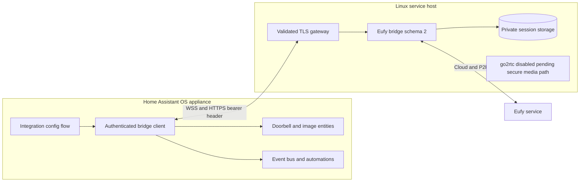
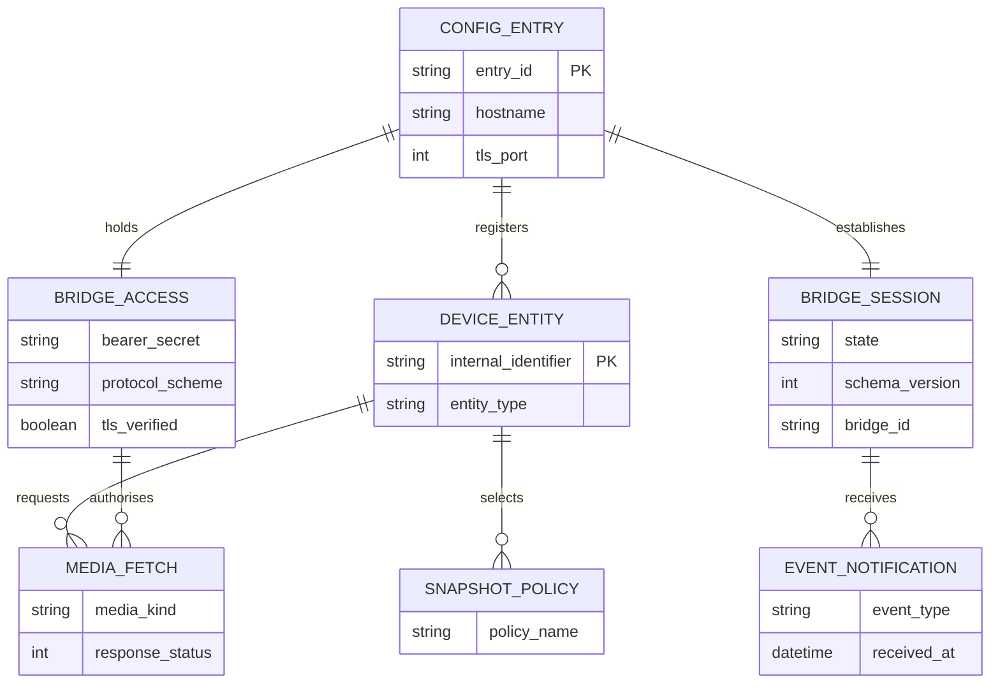
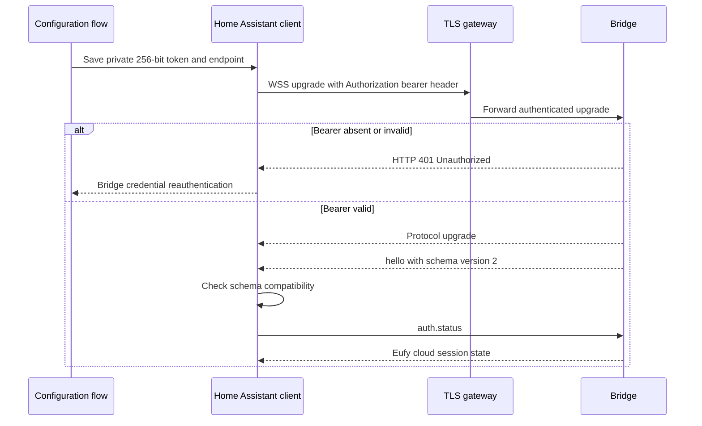
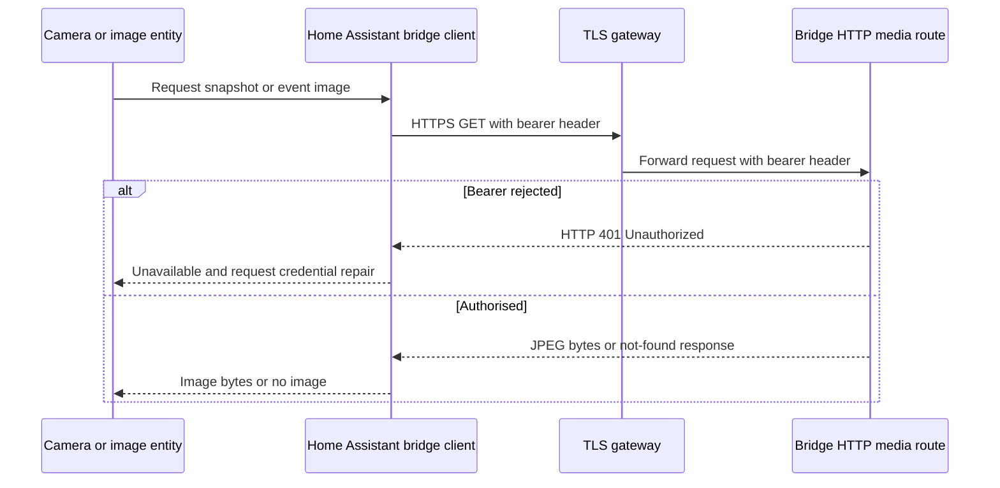
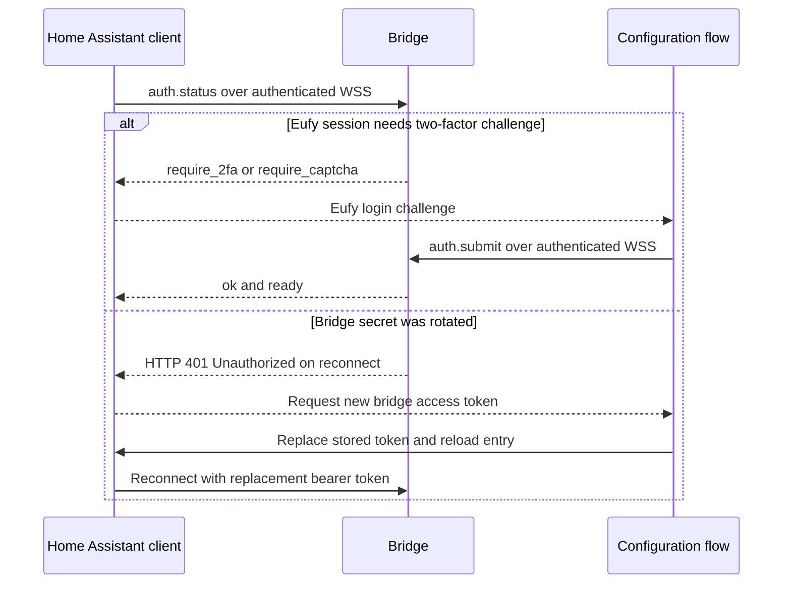

# Secure Home Assistant integration architecture

Status: design baseline for the development branch; **not deployment-ready**.
Companion bridge: [cfmanco/ha-eufy-sdk-bridge](https://github.com/cfmanco/ha-eufy-sdk-bridge/tree/dev/security-hardening), protocol schema 2.
Public documentation discloses **roles and CPU architectures only** (ARM64/AMD64 where applicable), never actual appliance models, internal addresses, serials, service hostnames, account identifiers or credentials.

## 1. Scope, trust boundaries and non-goals

This integration runs in Home Assistant OS on a separate physical appliance. The bridge runs as an unprivileged service on a separate Linux host. No Home Assistant container, Docker mount or custom daemon is installed on the Home Assistant appliance.

Deliver authenticated Eufy doorbell notifications, state, two-factor and captcha handling, snapshots and last-event images. Preserve the existing HACS entry lifecycle, entity identifiers, device events, snapshot policies and reconnect semantics. **Do not expose direct RTSP/WebRTC before the cross-host media path is authenticated and encrypted.** Until that is implemented and verified, live video remains disabled, intentionally.

Threats: unauthorised clients reading images/events, unauthorised WebSocket commands, bearer credentials observed on the network or logs, silent fallback to plaintext, leaked long-lived stream URLs, insecure recovery after token rotation, and camera wake-ups during failed requests.

## 2. Component / deployment diagram

Host loopback cannot be reached directly from the separate Home Assistant appliance. Deploy a restricted TLS gateway with a trusted certificate and DNS name. The gateway must forward the `Authorization` header to the bridge, must not log it, and must restrict client access. The bridge's unauthenticated health endpoint is for liveness only. The bridge remains inaccessible directly from other network segments.

## 3. Logical ERD

This is a **logical relationship model**, not a proposal for a new database. Home Assistant already persists configuration entries; event images and live client state are transient. Secret values are never exported into documentation or diagnostics.

Only the trusted Home Assistant configuration store holds the bearer secret; it is never used in an entity attribute, RTSP URI, URL query, log line or public diagnostics output. A client reconnection uses the stored secret and fresh TLS verification.

## 4. WebSocket interaction

A bridge-client HTTP 401 is distinct from the Eufy cloud requesting a verification code. Never treat a failed bridge token as a transient cloud login state, and never retry indefinitely with the same rejected credential. Legacy protocol schema 1 is not an allowed fallback.

## 5. Snapshot and event image interaction

The request is authorised before any camera P2P wake-up or stored-image read. The media client must be shared between camera and last-event entities rather than duplicating credentials. All response objects must be closed. A 404 means no media; a 401 means access denied and must not be silently turned into 404.

## 6. Session recovery and token rotation

## 7. Live video security decision

The existing `EufySdkCamera.stream_source()` emits `rtsp://host:port/id` without authentication. The hardened bridge deliberately confines RTSP to loopback and disables go2rtc in its development Compose configuration. Merely adding an HTTP bearer token does not protect RTSP traffic or make cross-host video work.

Candidates: (A) route video through a purpose-built authenticated TLS media gateway that the Home Assistant stream stack supports, or (B) carry a narrowly exposed RTSP listener over an authenticated encrypted network overlay, with ACLs restricting it to the Home Assistant appliance. Both require cross-host interoperability and leakage testing. **Selected interim behaviour:** preserve stills/events while disabling advertised live-stream support; do not invent a proxy URL or embed a long-lived token in a video URL.

## 8. Acceptance conditions

- Configuration/reauth does not display or log the bridge token; invalid/rotated token has an actionable repair path.
- WS upgrade uses `wss://`, authenticated media uses `https://`; both validate the gateway certificate.
- Schema 2 is required; no insecure downgrade or plaintext fallback exists.
- Snapshot, event-image, doorbell push, reconnect and Eufy 2FA work after the client changes.
- Live-stream capability is not exposed until the separate secure media design has passed end-to-end tests.
- CI tests include negative access cases; a real two-host installation test remains a release gate.
